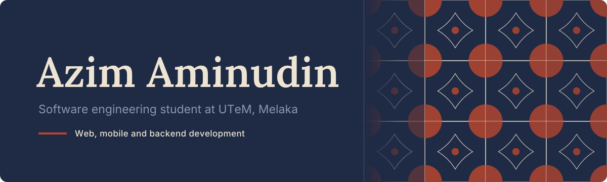
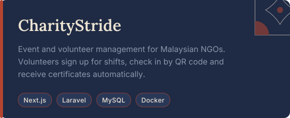
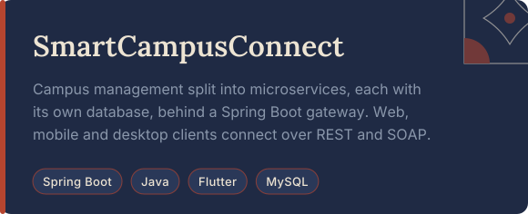
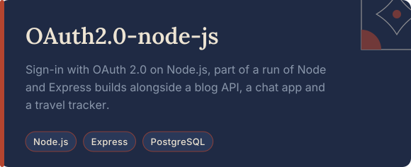
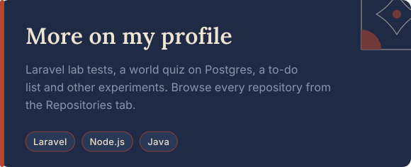

  
  
  
  

 

I'm a software engineering student at Universiti Teknikal Malaysia Melaka (UTeM). I build full-stack web applications, mobile apps and backend systems, from small experiments to complete platforms, and I enjoy turning real-world problems into software people can actually use.

 

 

  
  
  
  

 

  

  
  

  

  

